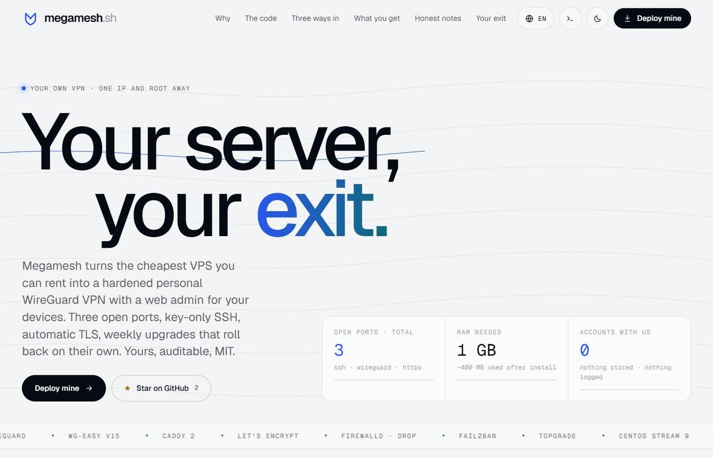
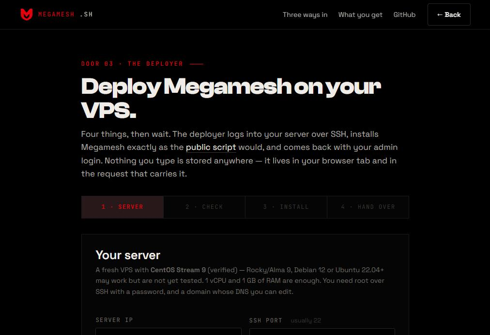

<div align="center">


# Megamesh

**Your server, your exit.**

<a href="https://megamesh.sh"></a>


<a href="https://megamesh.sh"></a>

<p>Renting a tunnel, you are a <strong>subscriber</strong>: a shared exit, a privacy policy you take on faith, a company you cannot audit.<br>Running one, you are the <strong>operator</strong>: your own hardened WireGuard VPN on a 1 GB VPS — your keys, one admin, every line on GitHub.</p>
<p>One VPS, one domain, one admin. WireGuard for the tunnel, a web UI with QR codes for your devices, a certificate that renews itself, a firewall with exactly three doors, and weekly upgrades that roll back if they break anything.</p>

</div>

<table>
<tr>
<th width="33%" align="left"><sub>DOOR 01 · YOU RUN SERVERS</sub><br><a href="#01--script-if-you-run-servers">The script</a></th>
<th width="33%" align="left"><sub>DOOR 02 · YOU HAVE AN AI AGENT</sub><br><a href="#02--prompt-if-you-have-an-ai-agent">The prompt</a></th>
<th width="33%" align="left"><sub>DOOR 03 · YOU JUST WANT A VPN</sub><br><a href="https://megamesh.sh/deploy/">The deployer</a></th>
</tr>
<tr valign="top">
<td>One idempotent bash file, every setting an environment variable, nothing interactive. Read it, then run it as root on a fresh VPS with two env vars: domain and email.</td>
<td>Paste <a href="PROMPT.md"><code>PROMPT.md</code></a> into any agent that can run shell commands over SSH. It carries the rules, the order of operations and the six traps we hit, so the agent starts at the end.</td>
<td>A form at <a href="https://megamesh.sh/deploy/">megamesh.sh/deploy</a>: IP, root password, domain, email. It changes the root password to one you choose, loads the same program, hands you the admin login and one DNS record, then forgets you.</td>
</tr>
<tr valign="top">
<td><sub><b>You bring</b> SSH, a domain, ten minutes<br><b>Hardening</b> full — key-only SSH once a key exists, every option yours</sub></td>
<td><sub><b>You bring</b> the server details, a browser tab for DNS<br><b>Hardening</b> full — the prompt enforces it and verifies by reading state</sub></td>
<td><sub><b>You bring</b> four fields and patience for one coffee<br><b>Hardening</b> nice, not finished — a fresh root password, but SSH keeps password login until a techie friend adds a key</sub></td>
</tr>
</table>

<div align="center">
<p><a href="https://megamesh.sh">megamesh.sh</a> · <a href="#what-you-get">What you get</a> · <a href="#vpn-only-mode">VPN-only mode</a> · <a href="#keeping-it-updated">Updates</a> · <a href="#whitelisting-the-author">Whitelist me</a> · <a href="#the-website">The website</a> · <a href="docs/HARDENING.md">Hardening</a> · <a href="docs/AUDIT.md">Audit</a> · <a href="docs/DNS.md">DNS</a> · <a href="docs/TROUBLESHOOTING.md">Troubleshooting</a> · <a href="docs/LOGBOOK.md">Logbook</a></p>
</div>

## The idea

Commercial VPNs ask you to trust a company you cannot audit, with servers you share with strangers. Rolling your own is cheap and well documented, yet most guides stop at "WireGuard is up" and leave the box with password SSH, a wide-open firewall and no updates — the reference server for this project had logged **76,073 failed SSH logins** in 25 days, with fail2ban "running" and zero jails.

Megamesh is the opinionated remainder. WireGuard for the tunnel, [wg-easy](https://github.com/wg-easy/wg-easy) for the profiles and QR codes, [Caddy](https://caddyserver.com) for the certificate, firewalld for a deny-by-default policy with exactly three doors, [topgrade](https://github.com/topgrade-rs/topgrade) on a weekly timer to keep packages *and* container images current with a health check and rollback, and the small set of host hardening you would want anyway.

It is written down three times — as a script that does it, as a prompt that teaches an agent to do it, and as a web page (the deployer) that does it for you — because each form reaches people the others do not. Before going public it was audited twice by three frontier models; the findings that held up were fixed and re-verified on the live server, the rest are listed with reasons ([docs/AUDIT.md](docs/AUDIT.md)).

## Three ways in

All three start from the same two facts — an IP and a root password — and end on the same box. The difference is how much you want to touch.

### 01 — Script, if you run servers

A fresh VPS, root, a domain whose A record you can set. Four distributions are verified end to end: CentOS Stream 9 (the reference server), Ubuntu 24.04 (a blank 1 vCPU / 1 GB VPS, installed through the web deployer on 2026-10-18), Rocky Linux 9.5 and Debian 12 (same box, reinstalled for each, 2026-10-19). AlmaLinux 9 shares Rocky's code path but has not been run.

```sh
curl -fsSLO https://megamesh.sh/megamesh.sh && less megamesh.sh      # read it first — it is one file
MEGAMESH_DOMAIN=vpn.example.com MEGAMESH_EMAIL=you@example.com bash megamesh.sh
```

Run standalone, the script fetches its own release tarball (helpers, configs, topgrade units) from GitHub; from a clone it uses the files next to it — `git clone https://github.com/paulfxyz/megamesh && cd megamesh && … bash megamesh.sh` is the same thing with the source in front of you. The installer is named after the domain, which is named after the installer; `install.sh` remains as a shim for links that predate the rename.

Then:

1. Create the DNS A record `vpn.example.com → <server IP>` ([docs/DNS.md](docs/DNS.md)). Caddy is already retrying and will pick up the certificate within minutes.
2. `cat /root/megamesh-admin-credentials` — the admin account was created during the install, before the UI was reachable. Move the password into your password manager, `shred -u` the file, log in at `https://vpn.example.com/`, and enable two-factor authentication under your account.
3. Add a device, scan the QR code, connect. `megamesh-status` shows handshakes, firewall, bans, certificate, next upgrade run and mode on one screen.

All settings are environment variables — see the top of [`megamesh.sh`](megamesh.sh): SSH port, WireGuard port, a public key to install, whether to lock passwords (`auto` = only if a key exists), admin username/password or let it generate one, skip the slow system update, install directory, VPN-only mode and its redirect, the upgrade schedule (`MEGAMESH_UPGRADE_SCHEDULE`, systemd `OnCalendar`), whether upgrades may reboot (`MEGAMESH_AUTO_REBOOT`), or `MEGAMESH_TOPGRADE=0` to skip topgrade entirely.

Re-running is safe and keeps your choices: the script has been run seven times on the reference server, the last ones over the live deployment with a connected peer and VPN-only mode on, keeping keys, peers, certificate and mode intact. A re-run that found the UI in VPN-only mode never writes the open configuration in between.

### 02 — Prompt, if you have an AI agent

Open [`PROMPT.md`](PROMPT.md), fill in the server block (IP, root password, OS, domain, email, your public key), paste it into any agent that can run shell commands over SSH. The prompt carries the goal, the rules (change the root password first, never disable passwords before a key login works, never print secrets, verify by reading state) and the traps we hit so the agent does not have to find them again:

- the 1 GB VPS whose first `dnf update` gets OOM-killed because the image's `/swapfile` was never activated
- the provider image shipping `/etc/docker/daemon.json` with `"iptables": false`, so Docker silently publishes nothing
- the wg-easy container's legacy `iptables` needing nine kernel modules on the host or `wg0` never comes up
- fail2ban installed and active with zero jails
- Docker's `docker-forwarding` firewalld policy letting *any* published port through, which is why only two are published
- the unauthenticated first-run wizard that whoever opens the URL first gets to complete

The reference deployment was done exactly this way, by [Perplexity Computer](https://www.perplexity.ai/computer) over SSH, with the owner supplying only the server details and a logged-in browser tab for the DNS change. The full account is in [docs/LOGBOOK.md](docs/LOGBOOK.md).

### 03 — The deployer, if you just want a VPN

<a href="https://megamesh.sh/deploy/"></a>

Open [megamesh.sh/deploy](https://megamesh.sh/deploy/). Four steps on one page:

1. **Server** — the public IP, the root password your provider emailed you, the domain you want the VPN to answer on, an email for certificate notices. Optionally an SSH public key, and optionally — recommended — a **new root password**: the one from the provider has already travelled by email, so the deployer replaces it on the server before installing anything (there is a generator next to the field). Save it in your password manager; it is shown again at hand-over.
2. **Check** — the page logs in once over SSH, confirms it is root on a supported x86_64 distribution, reads RAM, CPUs, whether Docker or a previous Megamesh is already there, and shows you the plan before touching anything. You tick a box that says what is about to happen.
3. **Install** — if you chose a new root password it is applied first (`chpasswd`), and every call from then on logs in with it, which is also the proof it took. Then the same `megamesh.sh` everyone else runs starts detached on your server; the page polls the install log, shows which phase it is in (connect · update · harden · containers · verify) and how long it has been running. A closed tab does not kill the install.
4. **Hand over** — admin URL, admin username and password, your new root password, the SSH line, each with a copy button; the A record to add (`your domain → your IP`); and a button that shreds the credentials file on your server once you have saved everything.

The honest part, also stated on the page: your root password transits through megamesh.sh for the minutes of the install and is never written anywhere — the endpoint is stateless, no database, no sessions, no logs of credentials, only a per-IP rate-limit counter. The deployer always keeps SSH password login on (`MEGAMESH_LOCK_SSH=no`) — even when you give it a key, which it installs — because it refuses to lock a door it cannot prove you can open; the result is a good VPN with a root password nobody else has seen, not a finished hardening — ask a techie friend to add a key, turn on `megamesh-lockdown`, and read [docs/HARDENING.md](docs/HARDENING.md) with you. Targets must be a public IPv4 with root password login. The deployer's source is in [`site/`](site/): one PHP file around [phpseclib](https://phpseclib.com), one JS file for the page.

## What you get

```
public internet ──▶ tcp/22    SSH, key-only, fail2ban
                ──▶ udp/51820 WireGuard (silent to anything but a valid handshake)
                ──▶ tcp/443   Caddy ──▶ wg-easy admin UI (internal bridge only;
                              optionally VPN-only, outsiders get a redirect)
                ──▶ icmp      ping + path-MTU types
                ──▶ *         DROP
```

| Layer | What | Why |
|---|---|---|
| Tunnel | WireGuard via `ghcr.io/wg-easy/wg-easy:15`, UDP 51820 | In-kernel, ~4k lines, modern crypto; wg-easy adds peers, QR codes, stats |
| Admin UI | `https://<domain>/` only, through Caddy on the Docker bridge | The UI port is never published; the single admin account is created unattended before 443 is reachable, so there is no public first-run wizard to race for |
| TLS | Caddy 2, Let's Encrypt via TLS-ALPN-01, HSTS, h1/h2, no port 80 | Zero-config certificates and renewals without opening HTTP |
| Firewall | firewalld public zone, target `DROP`, ICMP allow-list, opened before SSH moves | Three doors, everything else is a black hole; `firewall-cmd --list-all` is the audit |
| SSH | Key-only, `prohibit-password`, no forwarding, `MaxAuthTries 3` | Passwords and root-password login stay on until a key is present; `yes` without a key refuses to run |
| Brute force | fail2ban `sshd`, aggressive, 3 tries → 24 h, escalating to 30 d | Turns 76k attempts into a handful of banned IPs |
| Host | sysctl hardening, swap guard, `dnf-automatic`/`unattended-upgrades` daily (all updates on CentOS Stream, which ships no errata metadata; security-only elsewhere), Docker log rotation, `mem_limit`s | A 1 GB VPS that stays up and patched |
| Upgrades | `megamesh-upgrade` on a weekly systemd timer: [topgrade](https://github.com/topgrade-rs/topgrade) (`system` + `containers` steps) → `docker compose up -d` → health check (wg-easy healthy, `wg0` up, Caddy answering) → image rollback on failure → reboot only if the kernel asks | The containers get updates too, and a bad image cannot take the VPN down unattended |
| Containers | wg-easy with `NET_ADMIN` only (no `SYS_MODULE`, no `/lib/modules`), Docker userland proxy off | Smaller blast radius; the host loads the kernel modules |
| First start | wg-easy brought up alone, admin account proven (`/login`), only then Caddy | Fails closed: if setup did not happen, nothing becomes public |

Footprint on the reference server after install: ~400 MB RAM used including both containers, ~4 GB disk. Three helpers land in `/usr/local/bin`: `megamesh-status`, `megamesh-lockdown`, `megamesh-upgrade`.

## VPN-only mode

Once a device is connected, the admin UI can be made reachable **only through the tunnel**; anyone else opening `https://vpn.example.com/` is redirected to a URL of your choice.

```sh
megamesh-lockdown render vpn-only https://example.com   # show + validate what would be applied, change nothing
megamesh-lockdown enable https://example.com            # refuses without a peer or without Docker userland-proxy off
megamesh-lockdown status
megamesh-lockdown disable
```

Public 443 stays open so Let's Encrypt keeps renewing, but the public sees a `302` and nothing else. The mechanism is a Caddy `remote_ip` matcher on the wg-easy container address — which only works because the installer turns Docker's userland proxy off; the measurements that led there are in [docs/HARDENING.md](docs/HARDENING.md#phase-2--vpn-only-admin-ui-megamesh-lockdown). Devices with split tunneling count as outsiders, by design.

Restricting SSH to the VPN as well is deliberately not offered yet: the obvious firewalld recipe does not match the traffic the host actually sees, and a wrong rule locks you out. The docs explain why and what a correct version needs. If you want to go further than firewalld, [xnftables](https://github.com/paulfxyz/xnftables) is the hand-written, deny-all nftables policy this project is the gentle cousin of.

## Keeping it updated

Two layers, both unattended, both installed by default:

- **Daily** — `dnf-automatic` / `unattended-upgrades` apply package updates (all updates on CentOS Stream, which publishes no errata metadata; security-only elsewhere).
- **Weekly** — Monday 04:30 server time by default, ±20 min jitter: `megamesh-upgrade`, a thin wrapper around [topgrade](https://github.com/topgrade-rs/topgrade) restricted to its `system` and `containers` steps.

```sh
megamesh-upgrade --dry-run        # what topgrade would do, touches nothing
megamesh-upgrade --no-reboot      # run now, never reboot
journalctl -u megamesh-upgrade    # every run, with the topgrade summary
systemctl list-timers megamesh-upgrade.timer
```

What a run does: remember the image ID each container runs → `topgrade` (packages, then `docker pull` of every local image) → `docker compose up -d` (recreates only what changed) → wait up to two minutes for wg-easy to be healthy with `wg0` up and Caddy answering on 443 → on success prune the old images, on failure re-tag the previous image IDs and recreate, so the VPN is back on the images that worked → if `dnf needs-restarting -r` (or `/var/run/reboot-required`) says the kernel changed and `MEGAMESH_AUTO_REBOOT=1`, reboot one minute later; containers come back on their own.

Topgrade is installed from its GitHub release as a static binary, **pinned by version and SHA-256** in `megamesh.sh`, with self-update off; it is updated when the pin is bumped here, not by itself. Its config is `/etc/megamesh/topgrade.toml` ([config/topgrade/topgrade.toml](config/topgrade/topgrade.toml)): only the two steps, non-interactive, `allow_root` for the systemd run. Image tags stay on major versions (`wg-easy:15`, `caddy:2-alpine`), so a weekly pull never jumps a major release. Honest note: the rollback branch has been reviewed and the happy path exercised on the reference server; a real failed upgrade has not yet happened to test it in anger.

## paulfleury.network — my official VPN

**`paulfleury.network` is my official, personal VPN exit, and this repository is its public source of truth.** It is the reference server everything above was built and audited on: a 1 vCPU / 1 GB VPS running exactly this code, with the hardening notes applied — key-only SSH, VPN-only admin, weekly health-checked upgrades. When my devices are on that tunnel, everything I do on the internet exits from one address:

| | |
|---|---|
| Hostname | `paulfleury.network` |
| IPv4 | `151.243.225.214` |
| Reverse DNS | `151.243.225.214` → `paulfleury.network` (forward-confirmed) |
| Official since | **Sunday 18 October 2026, 17:00 Europe/Lisbon** (16:00 UTC) |
| Machine-readable | [`egress.json`](egress.json) |

**Why publish it at all.** Beyond convenience, a declared exit address is a defence. Calumny, fake news, a "someone broke into our web app" accusation — every action on the internet leaves an address in a log somewhere. By declaring mine in public, with a start date, in a repository whose history cannot be quietly rewritten, I give myself leverage: any trace that comes from another address is, by my own prior declaration, not me on my VPN. It is not proof of innocence on its own — a declaration cannot be — but it is a public, dated, verifiable statement made before anyone had a reason to doubt it, and that is a much better position than explaining after the fact. Anyone can do the same with their own Megamesh box; the `egress.json` format is there to be copied.

The start date matters. Before Sunday 18 October 2026 at 17:00 Lisbon time, `151.243.225.214` belonged to whoever the hosting provider had leased it to; nothing that address did before that moment has anything to do with me, and I take no responsibility for it. From that moment on, traffic from it is my VPN. The `since` timestamp in `egress.json` is the same claim in machine-readable form. The test boxes used while developing Megamesh (such as `vpn.paulfleury.eu`) are not part of this declaration — only the hostname and address in the table are.

If you run a service and want to allow-list me — SSH on your own boxes, an admin panel, a rate-limit exemption, a geo-fence — that is the address to use. Verify it yourself rather than trusting this page: `dig +short A paulfleury.network` and `dig +short -x 151.243.225.214` must agree. If the address ever changes, the change lands here first, in `egress.json`, in a commit on `main`.

Read it as a convenience signal, never as the only control:

- It identifies my VPN server, not me. Anyone I hand a WireGuard profile to, or anyone who ever got root on that box, exits from the same address (today: nobody but me). Keep authentication in front of whatever you allow-list.
- Hosting providers reassign addresses — which is also why the address had a life before me. If I let the VPS lapse, the next customer inherits `151.243.225.214` before I can commit anything. Treat the entry as stale if the PTR stops matching or `egress.json` has not been touched in a year.
- Only IPv4 traffic *routed through the tunnel* exits here. A device of mine off the VPN is just another address on the café Wi-Fi.

## The website

<a href="https://megamesh.sh"></a>

[megamesh.sh](https://megamesh.sh) is the project's front door. It is light, quiet and typographic: a mist-grey page, ink type set in Geist, one electric blue that fades to teal in the gradient word, Geist Mono wherever the page talks to machines, and a few hairline wave paths drifting behind the hero. No illustrations — the content is the illustration: a manifesto that brightens word by word as you scroll (*renting a tunnel, you're a subscriber; running one, you're the operator*), a terminal with three tabs (script · agent · status) that types out the three ways in, live stars and release pulled from the GitHub API, a 76,073 count-up, and a pipeline drawing of the five install phases that lights up stage by stage. Door 03 is simply **the deployer**.

<a href="https://megamesh.sh/deploy/"></a>

Site features: a light/dark switch (dark is the same page at night — navy, not black), a pill navigation that collapses into a menu on phones, a floating dock with the install command and a back-to-top, a reading-progress bar, scroll reveals, and a logo that redraws itself on hover and pings on click. Audited on desktop, tablet and 375 px phones.

**Fifty languages.** The language picker (flags, search) switches the whole site — both pages, metadata, the deployer's live messages and error texts — into any of the 50 most spoken languages, right-to-left where the script demands it (Arabic, Urdu, Persian, Sindhi), with display type retuned for CJK and Indic scripts. English is the reference and lives in the HTML; every other language is a JSON file in [`site/assets/i18n/`](site/assets/i18n/) applied client-side and remembered on the device. The translations are machine-made and say so in the picker: generated by Gemini 3.6 Flash and then reviewed entry by entry by an independent model (GPT-5 mini) against the English source, both through OpenRouter, with deterministic checks that markup, placeholders, numbers, URLs and file paths survived untouched — anything that failed stayed in English rather than ship broken. Terminal content, commands and the installer's own log stay in English on purpose. Corrections from native speakers are the most welcome pull request there is: edit the JSON, keep the keys.

**Reviewing a language as a native speaker.** The most useful contribution to this repository needs no shell. Open [`site/assets/i18n/<code>.json`](site/assets/i18n/) for your language (codes are the ones in the picker: `fr`, `pt`, `hi`, `yue`…), read it next to [`en.json`](site/assets/i18n/en.json) — same keys, same order — and edit the values. Keys starting with `i.` are the landing page, `d.` the deployer, `j.` the messages the deployer shows while it works, `m.` the browser title and social preview. What to look for, in order of harm: meaning (a sentence that says something the English does not — especially around the root password, SSH and what is and is not verified), terminology (one word for one thing throughout: the deployer, hand-over, the exit, allow-list, tunnel; product names as in English), register (short, plain, confident; formal "you" where the language has one), natural phrasing, and label length (buttons and the pill navigation have no room; if your language needs more words, choose shorter ones rather than wrapping). Leave untouched everything between `<` and `>`, every `{placeholder}`, every URL, path, number and the words `megamesh.sh`, `WireGuard`, `wg-easy`, `Caddy`, `PROMPT.md`. Technical terms your community keeps in English (SSH, VPN, root, swap, port) may stay in English; there is no prize for translating `root`. Right-to-left languages: write normally, the page handles direction. Then open a pull request titled `i18n: <language>` — or, if Git is not your thing, paste the corrected entries into an issue. Running `python3 site/tools/i18n_audit.py <code>` before you send it will tell you if a tag, number or URL went missing; the GitHub review will run the same check. Your name goes in the file's `_meta.reviewers` if you want it there.

The pipeline is two scripts in [`site/tools/`](site/tools/): `i18n_extract.py` tags every user-facing string in the HTML with a `data-i18n` key (keys are stable across edits; new elements get new keys) and harvests the `t('key', 'English')` fallbacks from the JavaScript into `en.json`; `i18n_translate.py` translates only what is missing or changed, per language, validates, and optionally runs the review pass (`--review`); `i18n_audit.py` checks every file for stray letters from a neighbouring script, inconsistent translations of the same English term, lost product names and leftover English, and can fix only the flagged entries (`--fix`). Everything is static HTML/CSS/JS plus one PHP endpoint, in [`site/`](site/):

```
site/index.html          ← the landing page
site/deploy/             ← the deployer (index.html + deploy.js, no framework)
site/api/deploy.php      ← the stateless endpoint: check · passwd · start · status · handover · forget
site/api/lib/            ← autoload.php; phpseclib 4 + constant_time_encoding are vendored at deploy time, not committed
site/assets/             ← style.css (tokens, both themes, RTL/CJK tuning), ui.js (theme, i18n, languages, terminal, GitHub stats, reveals), og.png
site/assets/i18n/        ← en.json (master, generated) + 49 reviewed machine translations
site/tools/              ← i18n_extract.py, i18n_translate.py (OpenRouter)
site/megamesh.sh         ← a copy of the installer; https://megamesh.sh/megamesh.sh redirects to this repository's main branch so it cannot go stale
site/.htaccess           ← content types, dotfile denial, security headers; api/lib/ is unreachable from the web
```

How the deployer works: the browser posts the fields to `deploy.php`; `check` opens an SSH session with phpseclib, verifies root and the distribution, and returns what it saw. `passwd` (optional) pipes `root:<new>` through `chpasswd` and the client switches to the new password for every later call. `start` uploads an env file, launches `nohup setsid bash megamesh.sh` with its output in `/root/megamesh-install.log`, and returns immediately. `status` tails that log on every poll and watches for the exit marker; `handover` reads `/root/megamesh-admin-credentials` once; `forget` shreds it and the env file. Credential-bearing actions are rate-limited per client IP (12 per 10 minutes); nothing else is written on the hosting side. It runs on plain shared PHP hosting — no composer, no database, nothing to keep alive. To host your own copy, drop the vendored libraries next to `autoload.php` as described in [`site/api/lib/README.md`](site/api/lib/README.md) and upload `site/`.

## Repository layout

```
megamesh.sh                   ← the installer: idempotent, non-interactive, env-var driven (install.sh is a shim)
PROMPT.md                     ← the agent prompt, with the known traps and the credential rules
egress.json                   ← the author's public egress address, machine-readable
SECURITY.md                   ← how to report a vulnerability, scope, what to expect
scripts/status.sh             ← one-screen health check (installed as megamesh-status)
scripts/lockdown.sh           ← VPN-only mode switch (installed as megamesh-lockdown)
scripts/upgrade.sh            ← topgrade wrapper: health check, rollback, reboot (installed as megamesh-upgrade)
config/                       ← the files running on the reference server (Caddyfile is the VPN-only render)
  compose.yml                 ← wg-easy (NET_ADMIN only) + caddy, two published ports, mem limits
  Caddyfile                   ← TLS-ALPN, HSTS, h1/h2, Server header stripped
  wg-easy.env                 ← container env (INIT_* lines are removed after first start)
  megamesh.conf               ← /etc/megamesh.conf, settings the helpers read
  firewalld/public.sh         ← the three-door policy as firewall-cmd commands
  topgrade/topgrade.toml      ← /etc/megamesh/topgrade.toml: only system + containers, non-interactive
  systemd/megamesh-upgrade.*  ← oneshot service + weekly timer
  sshd/00-megamesh-hardening.conf
  fail2ban/megamesh-sshd.local
  sysctl/99-megamesh-hardening.conf
  modules-load/megamesh.conf
  docker/daemon.json
site/                         ← megamesh.sh: landing page and the deployer (see "The website")
docs/
  HARDENING.md                ← what is in place and why; VPN-only mode and how it was measured; upgrade policy
  AUDIT.md                    ← the three-model audit: findings, fixes, what was declined
  audit/                      ← the raw reports, both rounds
  DNS.md                      ← A record, PTR (incl. Hostkey), and why not to self-host ns1/ns2
  TROUBLESHOOTING.md          ← symptom → cause → fix
  LOGBOOK.md                  ← the reference deployment, hour by hour
  logo.svg · logo-mark.svg    ← the M-shield, on its tile and bare (currentColor)
  site.png · deployer.png     ← screenshots of megamesh.sh
```

## What this is not

- **Not a privacy service.** Your VPS provider sees your traffic exit their network; this hides you from the café Wi-Fi and your ISP, not from a subpoena.
- **Not multi-tenant.** One admin, your devices. wg-easy supports many peers, but the hardening assumes a single trusted operator.
- **Not tested everywhere.** Four distributions (CentOS Stream 9, Ubuntu 24.04, Rocky Linux 9.5, Debian 12), two providers, one VPS size. The deployer's full run — root-password change, install, resume after a closed tab, hand-over, credential shredding, and a second run that moved the box to a new domain — was exercised on the Ubuntu box (`vpn.paulfleury.eu`). AlmaLinux and non-default ports are reasoned, not run. Issues and PRs with a logbook of what you hit are the most useful contribution.
- **Not a replacement for reading.** `megamesh.sh` is ~500 lines of plain bash with comments. Read it before you run it as root on a machine you care about, and before you hand its URL to a web form.

## Status, naming, roadmap

v1.5.8 is the state of the reference server on 2026-10-18 after two audit rounds, the topgrade integration, the launch of [megamesh.sh](https://megamesh.sh) and its redesign ([CHANGELOG.md](CHANGELOG.md)). The project was called `proxy` for its first day; it is now **Megamesh**, a nod to [megastack.sh](https://megastack.sh), the author's cybersecurity consultancy.

- **Naming**: "Megamesh" as a word, in prose; `megamesh` or `megamesh.sh` in lower case when talking about the code, the command or the site.
- **Logo**: a single M whose two legs curve into the point of a shield, with one node where the strokes meet — [`docs/logo.svg`](docs/logo.svg) white on its blue tile, [`docs/logo-mark.svg`](docs/logo-mark.svg) bare, in `currentColor`. Wordmark: **Bricolage Grotesque 800**, `megamesh` with a smaller italic `.sh`. The mark draws itself in on load. Hover is one big zoom-in explosion: the shield overshoots to 2.3× with a flash and a burst of blue sparks, then settles larger with a stream of sparkles around it; the `.sh` goes blue. Click is the bigger move: a hard shrink, then a 3× pop with a double firework burst of streaks, squares and dots and a shockwave ring. No wave, no tilt, no breathing, nothing moves sideways — size and particles only, in the navigation and in the footer alike. CSS for the mark, a tiny canvas for the particles, all of it off under `prefers-reduced-motion`.
- **Planned**: native-speaker review of the translations, SSH-via-VPN with a confirm-or-rollback window.
- **Not planned**: OpenVPN, multi-user auth, turning this into a product.

## The story

I wanted a VPN that is mine, on a cheap VPS, with a QR code for my phone and nothing else listening. I also wanted to know whether I could hand an AI agent an IP and a root password and get a hardened box back without touching a terminal. The answer to both was yes, after the agent and I tripped over six things that were not in any guide. Then I asked three other models to tear the result apart before publishing it, twice, and they found more — including a lock-out bug in the very guard that was supposed to prevent lock-outs, and a re-run that quietly reopened a locked-down UI. Then I bought the domain, because a script, a prompt and a form reach three different people — and gave the form a bald man in a very good coat. This repository is all of those things, so the next person — or the next agent — starts at the end.

**Paul Fleury** — French internet entrepreneur in Lisbon, running [megastack.sh](https://megastack.sh), a cybersecurity consultancy; [LinkedIn](https://www.linkedin.com/in/paulfxyz/). Designed and operated with [Claude](https://www.claude.ai) and [Perplexity Computer](https://www.perplexity.ai/computer). Companion projects: [xnftables](https://github.com/paulfxyz/xnftables), [cup-of-news](https://github.com/paulfxyz/cup-of-news), [pplx-cost-transparency](https://github.com/paulfxyz/pplx-cost-transparency).

## License

[MIT](LICENSE). wg-easy is AGPL-3.0 and Caddy is Apache-2.0; both are used as unmodified container images. topgrade is GPL-3.0 and is installed as an unmodified release binary. phpseclib is MIT. "WireGuard" is a registered trademark of Jason A. Donenfeld; this project is not affiliated with WireGuard, wg-easy or Caddy.
