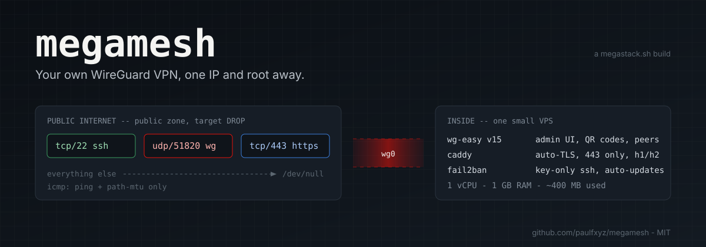

# proxy

<div align="center">




<p><strong>A personal WireGuard VPN with a web admin UI, hardened by default, on the cheapest VPS you can find.</strong></p>
<p>Two ways in: a script if you are a sysop, a prompt if you have an AI agent. Both start from the same two facts — an IP and a root password.</p>
<p><a href="#quick-start-sysop">Script</a> · <a href="#quick-start-ai-agent">Prompt</a> · <a href="#what-you-get">What you get</a> · <a href="docs/HARDENING.md">Hardening</a> · <a href="docs/DNS.md">DNS</a> · <a href="docs/TROUBLESHOOTING.md">Troubleshooting</a> · <a href="docs/LOGBOOK.md">Logbook</a></p>

</div>

## The idea

Commercial VPNs ask you to trust a company you cannot audit, with servers you share with strangers. Rolling your own is cheap and well documented, yet most guides stop at "WireGuard is up" and leave the box with password SSH, a wide-open firewall and no updates — the reference server for this project had logged **76,073 failed SSH logins** in 25 days, with fail2ban "running" and zero jails.

`proxy` is the opinionated remainder: one VPS, one domain, one admin. WireGuard for the tunnel, [wg-easy](https://github.com/wg-easy/wg-easy) for the profiles and QR codes, [Caddy](https://caddyserver.com) for the certificate, firewalld for a deny-by-default policy with exactly three doors, and the small set of host hardening you would want anyway. It is written down twice — as a script that does it, and as a prompt that teaches an agent to do it — because the second form survives distributions and providers the first one has never seen.

## What you get

```
public internet ──▶ tcp/22    SSH, key-only, fail2ban
                ──▶ udp/51820 WireGuard (silent to anything but a valid handshake)
                ──▶ tcp/443   Caddy ──▶ wg-easy admin UI (internal bridge only)
                ──▶ icmp      ping + path-MTU types
                ──▶ *         DROP
```

| Layer | What | Why |
|---|---|---|
| Tunnel | WireGuard via `ghcr.io/wg-easy/wg-easy:15`, UDP 51820 | In-kernel, ~4k lines, modern crypto; wg-easy adds peers, QR codes, stats |
| Admin UI | `https://<domain>/` only, through Caddy on the Docker bridge | The UI port is never published; a single admin account created by a one-time wizard |
| TLS | Caddy 2, Let's Encrypt via TLS-ALPN-01, HSTS, h1/h2, no port 80 | Zero-config certificates and renewals without opening HTTP |
| Firewall | firewalld public zone, target `DROP`, ICMP allow-list | Three doors, everything else is a black hole; `firewall-cmd --list-all` is the audit |
| SSH | Key-only, `prohibit-password`, no forwarding, `MaxAuthTries 3` | The installer refuses to disable passwords until a key is present |
| Brute force | fail2ban `sshd`, aggressive, 3 tries → 24 h, escalating to 30 d | Turns 76k attempts into a handful of banned IPs |
| Host | sysctl hardening, swap guard, `dnf-automatic`/`unattended-upgrades`, Docker log rotation, `mem_limit`s | A 1 GB VPS that stays up and patched |

Footprint on the reference server after install: ~400 MB RAM used including both containers, ~4 GB disk.

## Quick start (sysop)

A fresh VPS, root, a domain whose A record you can set. CentOS Stream 9 / Rocky / Alma 9 are tested; Debian 12 / Ubuntu 22.04+ have a best-effort branch that is not yet verified.

```sh
git clone https://github.com/paulfxyz/proxy && cd proxy
PROXY_DOMAIN=vpn.example.com PROXY_EMAIL=you@example.com bash install.sh
```

Then:

1. Create the DNS A record `vpn.example.com → <server IP>` ([docs/DNS.md](docs/DNS.md)). Caddy is already retrying and will pick up the certificate within minutes.
2. Open `https://vpn.example.com/`. The first visit redirects to `/setup/1`, a one-time wizard that creates **the** admin account; it disappears afterwards. Use a password-manager password. Enter `Host = vpn.example.com`, `Port = 51820`.
3. Add a device, scan the QR code, connect. `proxy-status` (installed as `scripts/status.sh`) shows handshakes, firewall, bans and certificate on one screen.

All settings are environment variables — see the top of [`install.sh`](install.sh): SSH port, WireGuard port, a public key to install, whether to lock passwords (`auto` = only if a key exists), skip the slow system update, install directory.

Re-running is safe; the script was run twice on the reference server, the second time over the live deployment, without recreating containers.

## Quick start (AI agent)

Open [`PROMPT.md`](PROMPT.md), fill in four values (IP, root password, OS, domain), paste it into any agent that can run shell commands over SSH. The prompt carries the goal, the rules (change the root password first, never disable passwords before a key login works, never print secrets, verify by reading state) and the traps we hit so the agent does not have to find them again:

- the 1 GB VPS whose first `dnf update` gets OOM-killed because the image's `/swapfile` was never activated
- the provider image shipping `/etc/docker/daemon.json` with `"iptables": false`, so Docker silently publishes nothing
- the wg-easy container's legacy `iptables` needing nine kernel modules on the host or `wg0` never comes up
- fail2ban installed and active with zero jails
- Docker's `docker-forwarding` firewalld policy letting *any* published port through, which is why only two are published

The reference deployment was done exactly this way, by [Perplexity Computer](https://www.perplexity.ai/computer) over SSH, with the owner supplying only the server details and a logged-in browser tab for the DNS change. The full account is in [docs/LOGBOOK.md](docs/LOGBOOK.md).

## Repository layout

```
install.sh                    ← the installer: idempotent, non-interactive, env-var driven
PROMPT.md                     ← the agent prompt, with the known traps
scripts/status.sh             ← one-screen health check (installed as proxy-status)
config/                       ← the exact files running on the reference server
  compose.yml                 ← wg-easy + caddy, two published ports, mem limits
  Caddyfile                   ← TLS-ALPN, HSTS, h1/h2, Server header stripped
  firewalld/public.sh         ← the three-door policy as firewall-cmd commands
  sshd/00-proxy-hardening.conf
  fail2ban/proxy-sshd.local
  sysctl/99-proxy-hardening.conf
  modules-load/proxy.conf
  docker/daemon.json
docs/
  HARDENING.md                ← what is in place and why; phase 2 (VPN-only UI / SSH)
  DNS.md                      ← A record, PTR, and why not to self-host ns1/ns2
  TROUBLESHOOTING.md          ← symptom → cause → fix
  LOGBOOK.md                  ← the reference deployment, hour by hour
```

## Phase 2, when you are ready

Once a device is connected, the admin UI and SSH can be restricted to the VPN itself, so the public internet sees only `udp/51820`. It is deliberately not the default — each step can lock you out if the tunnel is broken — and it is written down step by step in [docs/HARDENING.md](docs/HARDENING.md#phase-2--after-your-first-device-is-connected). If you want to go further than firewalld, [xnftables](https://github.com/paulfxyz/xnftables) is the hand-written, deny-all nftables policy this project is the gentle cousin of.

## What this is not

- **Not a privacy service.** Your VPS provider sees your traffic exit their network; this hides you from the café Wi-Fi and your ISP, not from a subpoena.
- **Not multi-tenant.** One admin, your devices. wg-easy supports many peers, but the hardening assumes a single trusted operator.
- **Not tested everywhere.** One distribution, one provider, one VPS size are verified. The Debian/Ubuntu branch and anything larger are reasoned, not run. Issues and PRs with a logbook of what you hit are the most useful contribution.
- **Not a replacement for reading.** `install.sh` is 300 lines of plain bash with comments. Read it before you run it as root on a machine you care about.

## Status and roadmap

v1.0.0 is the state of the reference server on 2026-10-18 ([CHANGELOG.md](CHANGELOG.md)). Planned: verifying the Debian/Ubuntu path on a second provider, a `lockdown.sh` for phase 2 with a confirm-or-rollback window, and a short domain for the project. Not planned: supporting OpenVPN, multi-user auth, or turning this into a product.

## The story

I wanted a VPN that is mine, on a cheap VPS, with a QR code for my phone and nothing else listening. I also wanted to know whether I could hand an AI agent an IP and a root password and get a hardened box back without touching a terminal. The answer to both was yes, after the agent and I tripped over five things that were not in any guide. This repository is those five things, plus the script, so the next person — or the next agent — starts at the end.

**Paul Fleury** — French internet entrepreneur in Lisbon. Designed and operated with [Perplexity Computer](https://www.perplexity.ai/computer). Companion projects: [xnftables](https://github.com/paulfxyz/xnftables), [cup-of-news](https://github.com/paulfxyz/cup-of-news), [pplx-cost-transparency](https://github.com/paulfxyz/pplx-cost-transparency).

## License

[MIT](LICENSE). wg-easy is AGPL-3.0 and Caddy is Apache-2.0; both are used as unmodified container images. "WireGuard" is a registered trademark of Jason A. Donenfeld; this project is not affiliated with WireGuard, wg-easy or Caddy.
